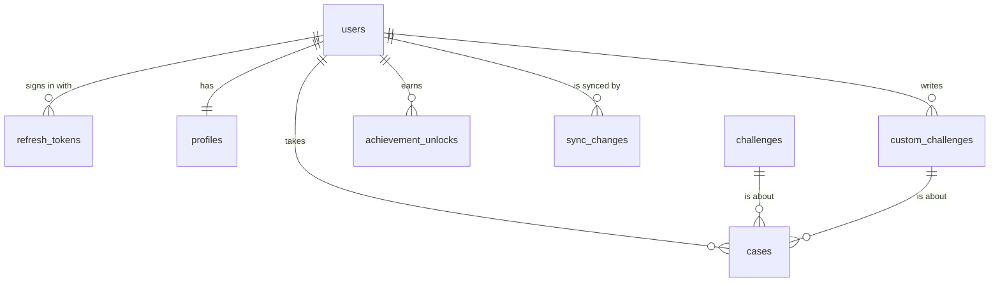
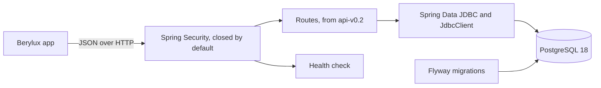

# Berylux API

The server for [Berylux](https://github.com/An3DCu/Berylux): accounts, sync and a weekly leaderboard for the Android app.

[](https://github.com/An3DCu/Berylux-API/actions/workflows/ci.yml)
[](LICENSE)


## Overview

Berylux hands you a few challenges every day and keeps score of the ones you close. The app works fully offline, as a guest. This API is what signing in will add: your cases on every phone you use, and a weekly board to compare Lux with other players who opt in.

The phone stays the source of what you did; the server is the source of what it's worth. Cases get their ids on the phone. They can be made offline and synced later. The server counts Lux from the cases themselves, with the app's rules, and never takes a total from the phone.

This is a work in progress. Version 0.1 is the foundation: the database, a closed-by-default API, and one command to run both. Accounts come next ([roadmap](#roadmap)).

## Features in api-v0.1

- **Database:** PostgreSQL with eight tables and a weekly leaderboard view, built only through Flyway migrations.
- **Challenges:** the app's 56 built-in challenges, loaded from the same [`challenges.json`](src/main/resources/seed/challenges.json) with the same ids.
- **Leaderboard view:** Lux by week for opted-in players, counted in SQL with the app's rules.
- **Closed by default:** every route needs a signed-in player unless it's named in [`SecurityConfig`](src/main/kotlin/com/anadcurukovic/berylux/api/security/SecurityConfig.kt).
- **One command:** Docker Compose runs the API and the database, both on this machine only.
- **API docs:** the OpenAPI spec is committed as [`docs/openapi.yaml`](docs/openapi.yaml), and a test keeps it current. Swagger UI runs locally.

## Endpoints

The full spec is [`docs/openapi.yaml`](docs/openapi.yaml).

| Method | Path | Signed in | What it does |
|---|---|---|---|
| GET | `/actuator/health` | No | Says UP or DOWN, with no details |
| GET | `/swagger-ui.html`, `/v3/api-docs` | No | The API docs, only when running locally; 404 anywhere else |
| POST | `/auth/register` | No | Makes an account with the guest's profile and signs in; a taken email can't be used |
| POST | `/auth/login` | No | Trades an email and a password for a pair of tokens |
| POST | `/auth/refresh` | No | Trades a refresh token for the next pair; the one sent stops working |
| POST | `/auth/logout` | Yes | Ends this phone's chain of refresh tokens |
| DELETE | `/account` | Yes | Coming in api-v0.2: deletes the account and everything in it |

Every other route answers 401.

## Security

Nobody can reach the API without signing in, except where a route is named open. Today that's the health check, register, log in, refresh, and the docs when running locally.

- A closed route answers 401, and one that doesn't exist answers the same. Nobody learns which routes are there.
- Errors never carry a stack trace, an exception name, a message or SQL.
- No sessions and no cookies. There's no sign-in state for another site to ride on.
- PostgreSQL and the API listen only on `127.0.0.1`.
- There are no default passwords. Compose won't start until `.env` has one.
- The container runs as a user without root.
- gitleaks finds nothing in the history.
- Passwords are hashed with Argon2id: 19 MiB of memory and 2 passes, as OWASP recommends. Only a few hash at once, and a burst of sign-ups can't take all the memory.
- A request body over 8 KiB is turned away. One without a stated length is cut off at 8 KiB while it's read.
- Register names each wrong field and never repeats the password.
- Register says when an email can't be used. Without sending email, it can't keep that secret.

- Access tokens are HS256 JWTs that last 15 minutes. They name the player's id and nothing else.
- The API won't start without a signing secret of at least 32 random bytes.
- Refresh tokens are 32 random bytes, stored only as their SHA-256, and last 30 days.
- Each refresh replaces the refresh token. An old one that comes back ends its whole chain, and that phone signs in again.
- Log in gives the same answer for a wrong password and an unknown email, in the same time.
- Answers with tokens are never kept by caches.

The sign-in routes are rate limited. Each window starts at the first try, and too many tries answer 429 with `Retry-After` in seconds.

| Route | Per address | Per email |
|---|---|---|
| `POST /auth/register` | 3 an hour, 10 a day | — |
| `POST /auth/login` | 5 a minute, 20 an hour | 5 tries in 15 minutes, whether or not the email has an account |
| `POST /auth/refresh` | 10 a minute | — |

The limits are kept in memory, in caches of at most 50,000 addresses or emails each. A flood of new addresses can't fill the memory. The address is the connection's own: behind a reverse proxy, the proxy's forwarded address will have to be trusted first.

Coming in api-v0.2:
- Deleting an account, and turning away its access tokens.

## Database

Eight tables and one view. Every change goes through a migration in [`db/migration`](src/main/resources/db/migration). The columns are in [`docs/erd.md`](docs/erd.md).



- **profiles:** one per account: the name, the sigil's seed, the time zone, the hour a game day starts, and whether the player is on the board.
- **cases:** each names one challenge, built-in or the player's own. A closed case has the day it was closed on.
- **sync_changes:** the change log a phone reads from its last cursor.
- **weekly_leaderboard:** a view, not a table. Lux is never stored.

## Tech stack

| Layer | Tools |
|---|---|
| Language | Kotlin 2.4 on JDK 21 |
| Framework | Spring Boot 4.1, Spring Security, Actuator, springdoc-openapi 3.2 |
| Data | PostgreSQL 18, Flyway, Spring Data JDBC with `JdbcClient` |
| Testing / CI | JUnit 5, Testcontainers, detekt, GitHub Actions |
| Running | Docker Compose, a multi-stage Dockerfile |
| Hosting | Not hosted yet |

## Architecture

Spring Security stands in front of everything and turns away any route it doesn't know. Behind it, the routes will talk to PostgreSQL through Spring Data JDBC, and through `JdbcClient` where the SQL matters, like sync and the leaderboard. Flyway owns the schema. The app's rules for Lux live in a SQL view. The board is always counted from the cases.



```text
src/main/kotlin/com/anadcurukovic/berylux/api/
  security/            closed by default, and the list of open routes
src/main/kotlin/db/migration/
                       the migration that loads the challenges
src/main/resources/
  db/migration/        the tables and the leaderboard view
  seed/                challenges.json, the same file as the app's
src/test/              Testcontainers tests against PostgreSQL 18
docs/                  the ERD and the OpenAPI spec
```

## Getting started

### Prerequisites

- [Docker Desktop](https://www.docker.com/products/docker-desktop/), running. Compose, `bootRun` and the tests all use it.
- A JDK 17 or newer to start Gradle, for example [Temurin](https://adoptium.net/). Gradle downloads JDK 21 for the build on its own.

### Setup

```powershell
git clone https://github.com/An3DCu/Berylux-API.git
cd Berylux-API
Copy-Item .env.example .env
```

On macOS or Linux, the last line is `cp .env.example .env`.

### Configuration

Open `.env` and fill in the password and the signing secret:

| Variable | What it is | Where to get it |
|---|---|---|
| `POSTGRES_DB` | The database's name | Keep `berylux` |
| `POSTGRES_USER` | The database user | Keep `berylux` |
| `POSTGRES_PASSWORD` | The database password | Any long random string. Only this machine's PostgreSQL uses it |
| `BERYLUX_TOKEN_SECRET` | Signs access tokens | 32 random bytes in Base64, from the command below |

Make the signing secret with:

```powershell
$b = New-Object byte[] 32; [Security.Cryptography.RandomNumberGenerator]::Create().GetBytes($b); [Convert]::ToBase64String($b)
```

On macOS or Linux: `openssl rand -base64 32`.

`.env` is ignored by git and never committed.

### Run

The API and the database together:

```powershell
docker compose --profile app up --build
```

Then open http://localhost:8080/actuator/health. Its answer says `"status":"UP"`. Stop it with Ctrl+C, and remove it with `docker compose --profile app down`.

For development, `bootRun` starts only the database in Docker and runs the API with the docs turned on:

```powershell
.\gradlew bootRun
```

Swagger UI is then at http://localhost:8080/swagger-ui.html.

### Tests

```powershell
.\gradlew build detekt
```

The same command CI runs. Testcontainers starts its own PostgreSQL 18 for the tests. After changing a route, `.\gradlew test -PupdateSpec` rewrites `docs/openapi.yaml`.

## Key engineering decisions

| Decision | Why | Trade-off |
|---|---|---|
| Closed by default | A new route stays private until it's named in `SecurityConfig` | Every open route needs a line there, and the PR says what it opens |
| Lux counted in a view from the cases | The phone can't claim Lux; there's one total, the server's | The Lux rules live in the app and in SQL, and both have to change together |
| Ids made on the phone (UUIDs) | A case can be made offline and synced later without renumbering | 16-byte keys instead of 8 |
| Spring Data JDBC and `JdbcClient` over JPA | Plain tables, and sync needs SQL I can read | More mapping written by hand |
| The app's `challenges.json`, same ids | A case points at the same challenge on both sides | The file is copied; a change goes in both repos |
| The docs only locally, the spec committed | Nothing extra open in production, and the spec still public | The spec test fails until `-PupdateSpec` is run after a change |
| Testcontainers with PostgreSQL 18 | Tests run on the same database as Compose, not a stand-in | The tests need Docker |

## Limitations

- No accounts yet. Every route except the health check answers 401, and the app doesn't call the API.
- Not hosted. It runs on your own machine.
- The tests need Docker running.
- `challenges.json` is a copy of the app's, kept in step by hand.

## Roadmap

- [ ] **api-v0.2 Accounts:** register, log in, refresh, log out and delete account, with the security above.
- [ ] **api-v0.3 Sync and leaderboard:** pull changes since a cursor, push batched writes, and the weekly board.
- [ ] **api-v0.4 Google sign-in:** the API checks Google ID tokens.

## Credits and license

- The server side of [Berylux](https://github.com/An3DCu/Berylux), which started as a university project at IBU (International Burch University) and was rebuilt from scratch afterwards.
- The challenges were written for the app.
- Libraries are used under their own licenses, mostly Apache 2.0.
- License: Apache 2.0. See [LICENSE](LICENSE).

## Contact

Anad Čuruković · [an3dcu.github.io](https://an3dcu.github.io) · [LinkedIn](https://linkedin.com/in/anadcurukovic) · ancur26@proton.me
