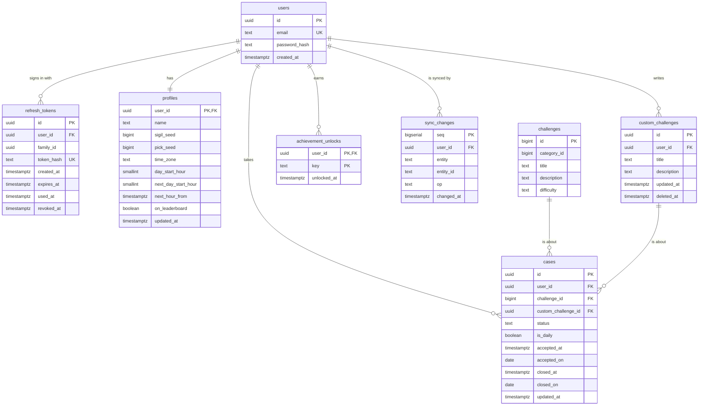

# Database

PostgreSQL, changed only through Flyway migrations in [`src/main/resources/db/migration`](../src/main/resources/db/migration). The app keeps its own copy of the same data in Room and syncs it with these tables.

## The rules in the schema

- **One profile per account.** Its time zone and the hour the day starts make game days on the server what they are on the phone. A new start hour waits in `next_day_start_hour` until `next_hour_from`, as in the app.
- **Ids a phone creates are UUIDs.** Cases and the player's own challenges get their id on the phone, offline, and the server keeps it.
- **Built-in challenges** come from the app's own `challenges.json`, copied to [`src/main/resources/seed`](../src/main/resources/seed) and loaded by the migration `V2__Load_challenges`, with the same ids. The server needs each one's difficulty to count Lux.
- **A case is about one challenge**, a built-in one or the player's own, never both. A closed case has the game day it was closed on, and only a closed case has one.
- **An own challenge that's deleted is kept** with `deleted_at`. That's how the deletion reaches the player's other phones.
- **Deleting an account** deletes everything that was theirs, through `on delete cascade`.
- **`sync_changes`** lists every change in order. A phone's cursor is the last `seq` it has seen.

## The weekly leaderboard

The view `weekly_leaderboard` gives the Lux each player earned in each week, from the cases they closed, for players who opted in. Weeks start on Monday and count game days, as on the app's Rivals board. Lux follows the app's rules: Easy 10, Medium 25, Hard 50; the daily case 1.5 times that with a half rounded up; the player's own challenges nothing. Drops don't take Lux off the board.
